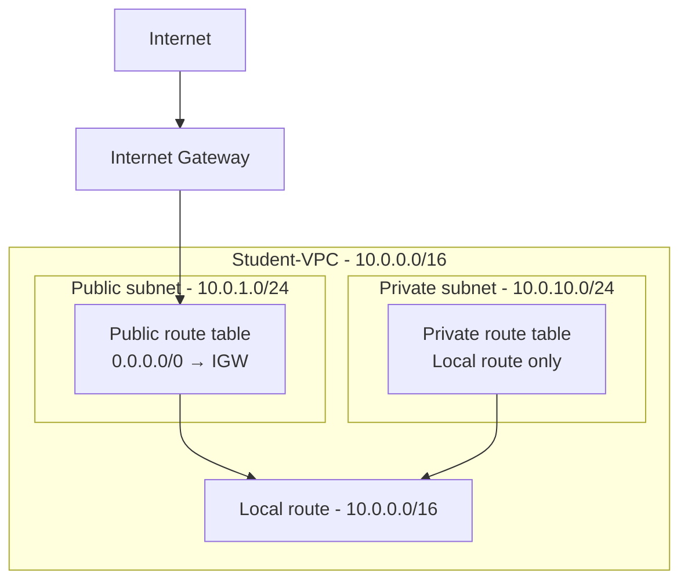

# Terraform-Based-AWS-VPC-Infrastructure
# Project 2: Terraform-Based AWS VPC Infrastructure

Infrastructure-as-Code project that provisions a custom AWS VPC with one
public subnet, one private subnet, an Internet Gateway, and separate
route tables using Terraform.

> **AWS Region:** `us-east-1` (N. Virginia)\
> **Terraform version used:** `1.17.1`\
> **AWS CLI version used:** `2.40.2`\
> **AWS provider installed by Terraform:** `6.73.0`\
> **Final state:** Applied, verified, and destroyed successfully. The
> nine Terraform-managed resources were removed after testing.

## Architecture



**Important:** The private subnet has no NAT Gateway and no route to the
Internet Gateway. It can communicate within the VPC through the local
route, but it does not have outbound internet access through this
design.

## Resources created

  Resource              Name / CIDR
  --------------------- -------------------------------------
  VPC                   `Student-VPC` --- `10.0.0.0/16`
  Public subnet         `Public-Subnet` --- `10.0.1.0/24`
  Private subnet        `Private-Subnet` --- `10.0.10.0/24`
  Internet Gateway      `Student-VPC-IGW`
  Public route table    `Public-RT`
  Private route table   `Private-RT`
  Public route          `0.0.0.0/0` → Internet Gateway
  Private route         VPC local route only
  Availability Zone     `us-east-1a`

Terraform reported **9 resources added, 0 changed, 0 destroyed** during
deployment.

## Prerequisites

-   Windows 10/11 with PowerShell.
-   AWS account.
-   An IAM identity with sufficient permissions to create and delete the
    VPC resources in this lab. Do not use the root account for routine
    Terraform work.
-   Terraform CLI.
-   AWS CLI v2.
-   VS Code (recommended).

Check installations:

``` powershell
terraform version
aws --version
```

Check the AWS CLI identity:

``` powershell
aws sts get-caller-identity
```

If using the named profile created for this lab:

``` powershell
$env:AWS_PROFILE = "terraform-lab"
aws sts get-caller-identity
```

Set the region for the current PowerShell session:

``` powershell
$env:AWS_DEFAULT_REGION = "us-east-1"
```

The project used a dedicated IAM user named `terraform-vpc-lab-user` and
an AWS CLI profile named `terraform-lab`. Use appropriately scoped
permissions for your own environment. Do not commit access keys or paste
them into documentation.

## Project directory

``` text
terraform-vpc-lab/
├── main.tf
├── variables.tf
├── outputs.tf
├── .gitignore
├── README.md
├── .terraform/              # generated by terraform init; do not commit
├── .terraform.lock.hcl      # commit this provider lock file
└── terraform.tfstate        # local state; do not commit
```

The `.terraform` directory and state files are generated locally. The
state file can contain sensitive infrastructure details. Keep it out of
Git.

## Step 1: Create the project folder

``` powershell
mkdir C:\Users\MIS\terraform-vpc-lab
cd C:\Users\MIS\terraform-vpc-lab
code .
```

Create these files in VS Code: - `main.tf` - `variables.tf` -
`outputs.tf` - `.gitignore`

## Step 2: Configure Terraform

### `main.tf`

The deployed configuration used the AWS provider 6.x, the region
variable, an account allow-list, default tags, and the following
resources: VPC, two subnets, Internet Gateway, two route tables, public
default route, and two subnet associations.

Use the exact configuration you validated and applied in your project.
The following is a complete equivalent configuration for recreating the
lab:

``` hcl
terraform {
  required_providers {
    aws = {
      source  = "hashicorp/aws"
      version = "~> 6.0"
    }
  }
}

provider "aws" {
  region              = var.aws_region
  allowed_account_ids = [var.aws_account_id]

  default_tags {
    tags = {
      Project     = "Terraform-VPC-Lab"
      Environment = "Learning"
      ManagedBy   = "Terraform"
    }
  }
}

data "aws_availability_zones" "available" {
  state = "available"
}

resource "aws_vpc" "student_vpc" {
  cidr_block           = var.vpc_cidr
  enable_dns_support   = true
  enable_dns_hostnames = true

  tags = {
    Name = "Student-VPC"
  }
}

resource "aws_subnet" "public_subnet" {
  vpc_id                  = aws_vpc.student_vpc.id
  cidr_block              = var.public_subnet_cidr
  availability_zone       = data.aws_availability_zones.available.names[0]
  map_public_ip_on_launch = true

  tags = {
    Name = "Public-Subnet"
    Type = "Public"
  }
}

resource "aws_subnet" "private_subnet" {
  vpc_id                  = aws_vpc.student_vpc.id
  cidr_block              = var.private_subnet_cidr
  availability_zone       = data.aws_availability_zones.available.names[0]
  map_public_ip_on_launch = false

  tags = {
    Name = "Private-Subnet"
    Type = "Private"
  }
}

resource "aws_internet_gateway" "igw" {
  vpc_id = aws_vpc.student_vpc.id

  tags = {
    Name = "Student-VPC-IGW"
  }
}

resource "aws_route_table" "public_rt" {
  vpc_id = aws_vpc.student_vpc.id

  tags = {
    Name = "Public-RT"
  }
}

resource "aws_route" "public_internet_route" {
  route_table_id         = aws_route_table.public_rt.id
  destination_cidr_block = "0.0.0.0/0"
  gateway_id             = aws_internet_gateway.igw.id
}

resource "aws_route_table_association" "public_association" {
  subnet_id      = aws_subnet.public_subnet.id
  route_table_id = aws_route_table.public_rt.id
}

resource "aws_route_table" "private_rt" {
  vpc_id = aws_vpc.student_vpc.id

  tags = {
    Name = "Private-RT"
  }
}

resource "aws_route_table_association" "private_association" {
  subnet_id      = aws_subnet.private_subnet.id
  route_table_id = aws_route_table.private_rt.id
}
```

### `variables.tf`

``` hcl
variable "aws_region" {
  description = "AWS region for the lab"
  type        = string
  default     = "us-east-1"
}

variable "aws_account_id" {
  description = "AWS account ID allowed to deploy this lab"
  type        = string
  default     = "YOUR_AWS_ACCOUNT_ID"
}

variable "vpc_cidr" {
  description = "CIDR block for the VPC"
  type        = string
  default     = "10.0.0.0/16"
}

variable "public_subnet_cidr" {
  description = "CIDR block for the public subnet"
  type        = string
  default     = "10.0.1.0/24"
}

variable "private_subnet_cidr" {
  description = "CIDR block for the private subnet"
  type        = string
  default     = "10.0.10.0/24"
}
```

Replace `YOUR_AWS_ACCOUNT_ID` with your own AWS account ID before
running Terraform. Do not use another person's account ID.
Alternatively, supply the value through a non-committed
`terraform.tfvars` file.

### `outputs.tf`

``` hcl
output "vpc_id" {
  description = "ID of the Student VPC"
  value       = aws_vpc.student_vpc.id
}

output "vpc_cidr" {
  description = "CIDR block of the Student VPC"
  value       = aws_vpc.student_vpc.cidr_block
}

output "public_subnet_id" {
  description = "ID of the public subnet"
  value       = aws_subnet.public_subnet.id
}

output "private_subnet_id" {
  description = "ID of the private subnet"
  value       = aws_subnet.private_subnet.id
}

output "internet_gateway_id" {
  description = "ID of the Internet Gateway"
  value       = aws_internet_gateway.igw.id
}

output "public_route_table_id" {
  description = "ID of the public route table"
  value       = aws_route_table.public_rt.id
}

output "private_route_table_id" {
  description = "ID of the private route table"
  value       = aws_route_table.private_rt.id
}

output "availability_zone" {
  description = "Availability Zone used by both subnets"
  value       = aws_subnet.public_subnet.availability_zone
}
```

### `.gitignore`

``` gitignore
.terraform/
*.tfstate
*.tfstate.*
*.tfvars
*.tfplan
crash.log
crash.*.log
.terraformrc
terraform.rc
*.pem
*.key
.env
```

Commit `.terraform.lock.hcl` so provider selections remain reproducible.
Never commit state files, credentials, or secret variable files.

## Step 3: Initialize Terraform

``` powershell
terraform init
```

This downloads the AWS provider and initializes the working directory.

## Step 4: Format and validate

``` powershell
terraform fmt
terraform validate
```

Expected validation result:

``` text
Success! The configuration is valid.
```

## Step 5: Preview infrastructure changes

``` powershell
terraform plan
```

Review the plan before applying. During the original deployment, the
plan showed:

``` text
Plan: 9 to add, 0 to change, 0 to destroy.
```

The exact resource IDs will differ when you recreate the lab.

## Step 6: Deploy infrastructure

``` powershell
terraform apply
```

Read the proposed changes. Type `yes` only after confirming that the
plan creates the intended lab resources.

The completed deployment reported:

``` text
Apply complete! Resources: 9 added, 0 changed, 0 destroyed.
```

Display output values:

``` powershell
terraform output
```

## Step 7: Verify AWS resources using AWS CLI

Use your own VPC ID from `terraform output`. For the original
deployment, it was `vpc-084cb664049bd879e`.

Set a PowerShell variable:

``` powershell
$VPC_ID = terraform output -raw vpc_id
$VPC_ID
```

### Verify VPC

``` powershell
aws ec2 describe-vpcs --vpc-ids $VPC_ID --region us-east-1
```

### Verify subnets

``` powershell
aws ec2 describe-subnets --filters "Name=vpc-id,Values=$VPC_ID" --region us-east-1
```

Check: - Public subnet CIDR `10.0.1.0/24`; `MapPublicIpOnLaunch` is
`true`. - Private subnet CIDR `10.0.10.0/24`; `MapPublicIpOnLaunch` is
`false`.

### Verify Internet Gateway

``` powershell
aws ec2 describe-internet-gateways --filters "Name=attachment.vpc-id,Values=$VPC_ID" --region us-east-1
```

### Verify route tables

``` powershell
aws ec2 describe-route-tables --filters "Name=vpc-id,Values=$VPC_ID" --region us-east-1
```

Expected: - Public route table: local route `10.0.0.0/16` and default
route `0.0.0.0/0` to the Internet Gateway. - Private route table: local
route `10.0.0.0/16` only. - AWS also creates a main route table
automatically; it is normal to see three route tables in the VPC output.

### Verify Terraform has no pending changes

``` powershell
terraform plan
```

Expected when the deployed infrastructure matches the configuration:

``` text
No changes. Your infrastructure matches the configuration.
```

## Step 8: Destroy resources after testing

This lab was destroyed after verification. To recreate it, follow the
deployment steps above. To remove it after a future test:

First preview the deletion:

``` powershell
terraform plan -destroy
```

Check that only the resources managed by this lab are listed. The
original destroy plan should show:

``` text
Plan: 0 to add, 0 to change, 9 to destroy.
```

Then run:

``` powershell
terraform destroy
```

Review the plan and type `yes` when prompted.

Expected:

``` text
Destroy complete! Resources: 9 destroyed.
```

Verify that the VPC has been deleted:

``` powershell
aws ec2 describe-vpcs --vpc-ids $VPC_ID --region us-east-1
```

For a deleted VPC, AWS returns `InvalidVpcID.NotFound`. That is the
expected result.

**Safety:** Do not manually delete resources that Terraform manages
while the state is still in use. Do not run destroy if the plan includes
resources outside this lab. The original default VPC was not managed by
this Terraform configuration and was left untouched.

## Screenshots to capture

Create a `screenshots` folder and add screenshots from your own
deployment. The original lab was destroyed, so capture these again if
you recreate it.

  -----------------------------------------------------------------------
  Filename                            Screenshot content
  ----------------------------------- -----------------------------------
  `01-tool-versions.png`              PowerShell showing
                                      `terraform version` and
                                      `aws --version`

  `02-aws-identity.png`               `aws sts get-caller-identity`
                                      output; redact account details if
                                      desired

  `03-project-files.png`              VS Code Explorer showing Terraform
                                      files

  `04-terraform-init.png`             Successful `terraform init`

  `05-terraform-validate.png`         `terraform validate` success

  `06-terraform-plan.png`             Plan showing 9 resources to add

  `07-terraform-apply.png`            Successful Terraform apply and
                                      outputs

  `08-vpc-details.png`                AWS VPC Console showing Student-VPC
                                      and CIDR

  `09-subnets.png`                    AWS Subnets page showing public and
                                      private CIDRs

  `10-internet-gateway.png`           Internet Gateway attached to
                                      Student-VPC

  `11-route-tables.png`               Public and private route tables and
                                      their routes

  `12-no-changes.png`                 Terraform plan showing no changes

  `13-terraform-destroy.png`          Terraform destroy reporting 9
                                      resources destroyed

  `14-vpc-deleted.png`                CLI verification showing the VPC no
                                      longer exists
  -----------------------------------------------------------------------

Only include genuine screenshots. Redact access keys, secret keys,
tokens, sensitive account information, and unrelated personal data.

## Repository layout

``` text
terraform-vpc-lab/
├── README.md
├── main.tf
├── variables.tf
├── outputs.tf
├── .gitignore
├── .terraform.lock.hcl
└── screenshots/
    ├── 01-tool-versions.png
    ├── 02-aws-identity.png
    ├── 03-project-files.png
    ├── 04-terraform-init.png
    ├── 05-terraform-validate.png
    ├── 06-terraform-plan.png
    ├── 07-terraform-apply.png
    ├── 08-vpc-details.png
    ├── 09-subnets.png
    ├── 10-internet-gateway.png
    ├── 11-route-tables.png
    ├── 12-no-changes.png
    ├── 13-terraform-destroy.png
    └── 14-vpc-deleted.png
```

## What I learned

-   Infrastructure as Code using Terraform.
-   AWS provider configuration and variables.
-   VPC CIDR planning and subnetting.
-   Public and private subnet behavior.
-   Internet Gateway and route-table configuration.
-   Terraform initialization, formatting, validation, planning,
    applying, state inspection, and destruction.
-   AWS CLI verification of deployed infrastructure.
-   Safe cleanup and avoiding accidental deletion of unrelated AWS
    resources.

## Possible extensions

-   Add a second Availability Zone.
-   Add a NAT Gateway for controlled outbound access from private
    subnets.
-   Add security groups and network ACLs.
-   Deploy EC2 instances into the public and private subnets.
-   Add an Application Load Balancer and Auto Scaling Group.
-   Store Terraform state remotely in S3 with state locking configured
    according to current Terraform support.
